# MDExplorer — Interactive Molecular Dynamics Trajectory Explorer

A tool for exploring molecular dynamics (MD) simulations in the browser. You
upload the files from your simulation, and it shows the protein in 3D together
with graphs of the usual analysis measurements.

## The idea behind it

MD simulations are saved in a lot of different file formats, and every format
stores the same information in a different way. Normally that means writing
separate code for each one.

This project avoids that. It reads the file once, copies everything into plain
NumPy arrays inside a single `MolecularSystem` object, and then forgets where
the data came from. All the analysis code and the 3D viewer only ever talk to
that one object, so adding a new file format means changing only the reader.

```
   PDB                 |
   PSF + DCD           |
   GRO + XTC           |----> MolecularSystem ----> analysis + 3D viewer
   TPR + XTC           |      (NumPy arrays)
   PRMTOP + NC         |
```

A `MolecularSystem` holds:

* one array per atom property, which never changes: `names`, `resids`,
  `resnames`, `elements`, `masses`
* the coordinates, which do change, in one array of shape
  `(n_frames, n_atoms, 3)`
* the time of each frame

## What it measures

Water molecules and ions are removed before every calculation, otherwise the
solvent box around the protein would dominate the results.

| Measurement | What it tells you | How it is done |
| --- | --- | --- |
| RMSD | how far the shape has moved from the starting structure | our own Python code, using the Kabsch algorithm to remove the tumbling of the molecule (NumPy does the SVD step of the alignment) |
| RMSF | which residues are flexible and which are rigid | our own Python code, one value per alpha carbon, aligned with the same Kabsch step as RMSD |
| Radius of gyration | how compact the folded protein is | our own Python code, mass weighted |
| Centre of mass | whether the protein is drifting through the box | our own Python code |
| Hydrogen bonds | whether the folded structure is holding together | our own Python code, the Baker-Hubbard geometric rule: H...acceptor under 2.5 A and a donor-H...acceptor angle over 120 degrees. Each bond is counted as **within a chain** (intra-chain) or **between two chains** (inter-chain), by the chain label of its donor and acceptor |
| SASA | how much surface is exposed to water | freesasa (Shrake-Rupley, 960 points per atom, or 100 for the faster option) |
| Secondary structure | the helix / sheet / coil percentages | mdtraj (DSSP, simplified 3-class output: H, E, C) |
| Torsion angles (phi / psi) | the backbone angles of each residue, frame by frame | mdtraj (`compute_phi`, `compute_psi`), stored per residue; blank where an angle does not exist (phi of a chain's first residue, psi of its last) |
| PCA | the main directions in which the protein moves | our own NumPy code: every frame's alpha carbons fitted onto frame 0 (the same Kabsch step), then the principal components from an SVD |

SASA, secondary structure and the torsion angles use a library because the algorithms
behind them are much bigger than the rest. Everything else is calculated directly from
the NumPy arrays.

## Everything is calculated once, at load

All the work happens right after **Load simulation**: every measurement, the RMSD against
**every** possible reference frame (a frames x frames table), the 3D picture of every frame
and the CSV files. Everything is kept as NumPy arrays, so once the page appears, clicking a
point on a graph, moving the frame slider or changing the RMSD reference frame only looks
values up and answers at once. Loading takes longer in exchange; see Known limitations.

## What the page does

* **3D structure, drawn by PyMOL**: cartoon, ligands as sticks, and magenta dots on the
  protein residues within 5 A of a ligand (the binding pocket). Black background, like PyMOL.
  * **Free rotation** (on by default): drag to rotate, scroll to zoom, right-drag to move.
    These are PyMOL's own 3D shapes, exported and drawn in the browser with three.js using
    PyMOL's lighting settings and depth cueing, so it looks like the PyMOL picture.
  * Untick it for the **still PyMOL picture** of the frame. It changes frame instantly.
  * In both, **click an atom** (the alpha carbon of a residue, or any ligand atom) to label it
    with its chain, residue and atom name. Click a second atom to get a **yellow dashed line
    with the distance** in A, like PyMOL's distance measurement. In the still picture the
    labels stay when you change frame, so you can watch a distance change.
  * **Colour the protein by** (sidebar): secondary structure (helices red, strands yellow,
    loops green, the default), rainbow (blue at the first residue to red at the last) or chain.
* **Play frames**: pick a range of frames and the speed, and play them to watch the protein
  move. Stop, or any other click, ends it.
* the graphs can be clicked to jump the 3D view to that frame
* dragging a box across the RMSD, Rg or H-bond graph selects a range of frames, and the
  averages over that range are shown underneath
* **Graphs**: RMSD, RMSF, radius of gyration, **hydrogen bonds** (within chains, between
  chains and total) and **PCA** (each frame as a dot along the first two principal components,
  coloured by time; clicking a dot jumps to that frame)
* **Torsion angles**: pick a residue to see its phi and psi over the whole trajectory, next to
  a Ramachandran plot of every residue in the frame on screen
* if one measurement cannot be calculated, the page says which one and shows
  the reason, and the other measurements still appear
* **Use every Nth frame** (sidebar): a long trajectory can be read every 10th or
  100th frame. The frames keep their original times and numbers.
* **RMSD reference frame**: RMSD is measured against the first frame unless you
  pick another one. Every reference was calculated at load, so the switch is instant.
* **GROMACS-style graphs**: one checkbox switches the graphs to time in ns and
  distances in nm, like `gmx rms`, `gmx gyrate` and `gmx rmsf` plots. Clicking a
  point still jumps to the right frame. The numbers under the graph stay in ps
  and A.
* **Download the results** as two CSV files: every per-frame value (now including the
  within/between-chain hydrogen bonds and PC1 and PC2), and the RMSF of each residue.

## Screenshots

The screenshots use Adenylate Kinase (214 residues, 3,341 atoms, 98 frames)
from the MDAnalysis test files (`adk.psf` + `adk_dims.dcd`), loaded through the page with
every frame, SASA and Fast SASA on, and the default colours.

**Overview: the sidebar (files, "Use every Nth frame", the SASA tick boxes, high quality
render and the colour scheme), simulation information and the 3D structure.** Loading these
98 frames with SASA took about 200 s on the development PC; after that every click answers
at once.

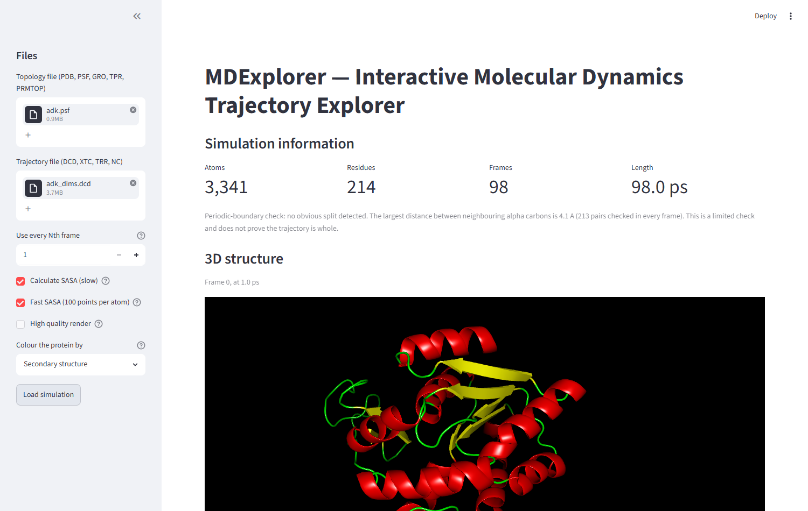

**Free rotation.** PyMOL's own 3D shapes, turned with the mouse. Two atoms were clicked:
each gets a label (chain, residue, atom) and the yellow dashed line gives their distance in A.

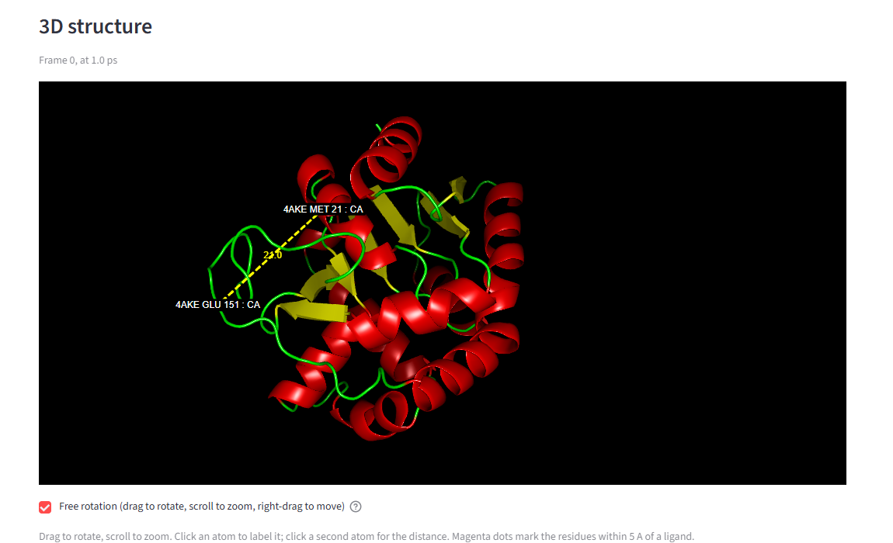

**The still PyMOL picture** (free rotation unticked), with two clicked atoms and their
distance. Here the labels stay when the frame changes, and the distance follows the frame.

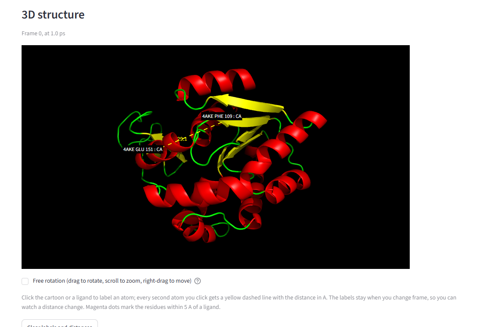

**Colour schemes** (sidebar, "Colour the protein by"): secondary structure (top left),
rainbow (top right) and chain (bottom left), drawn by PyMOL; bottom right is the free-rotation
view in secondary-structure colours.

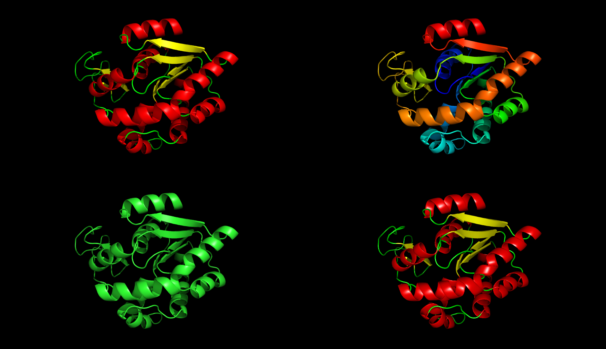

**Play frames**: choose the range and the speed, then Play.

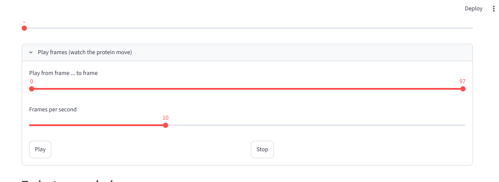

**RMSD graph with a selected range.** The red dashed line marks the frame shown in 3D;
clicking a point jumps to that frame. Dragging a box (after picking the box select tool in
the chart's toolbar) shades a range of frames...

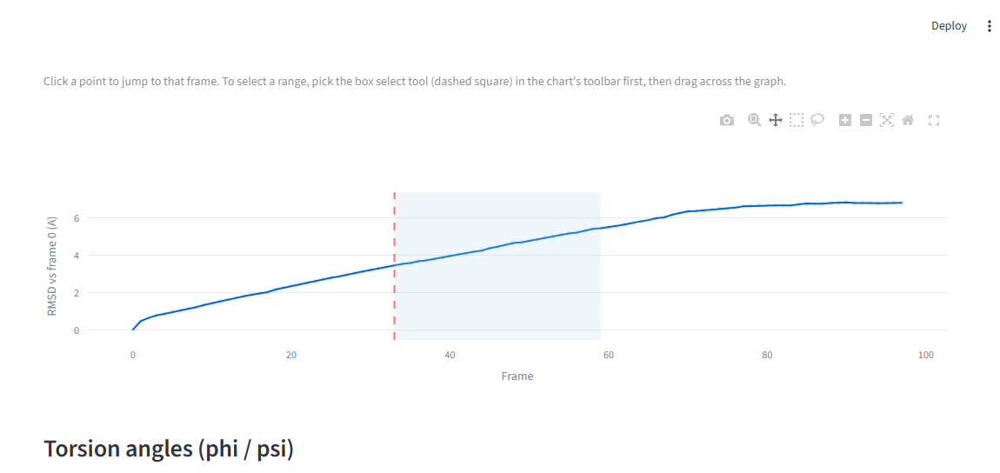

...and shows the averages over those frames:

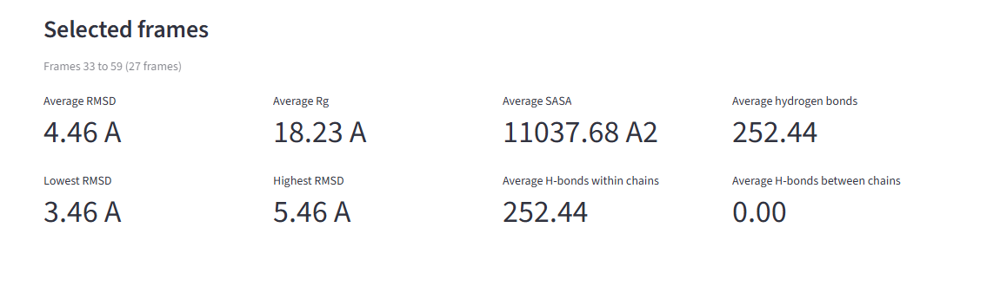

**Hydrogen bonds**: within chains, between chains and the total. This protein has one chain,
so "within" is the total and "between" is 0.

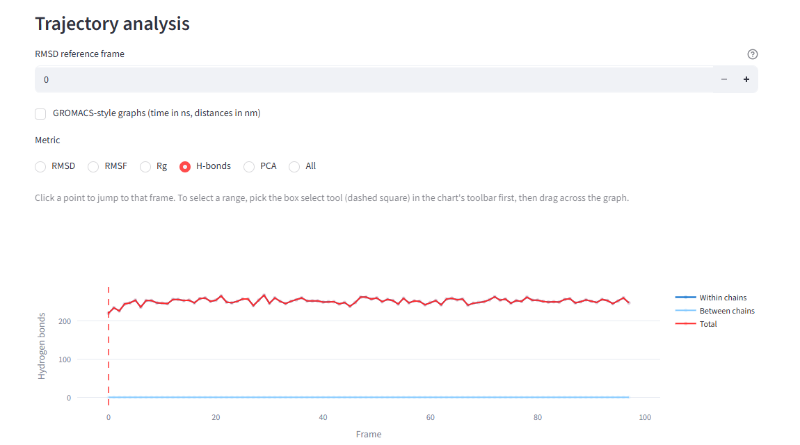

**PCA**: each dot is one frame, placed along the two biggest movements of the alpha carbons
and coloured by time (here PC1 explains 90% of the motion). Clicking a dot jumps to that frame;
the red ring marks the frame on screen.

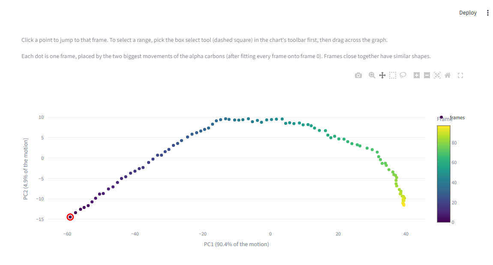

**RMSF per residue**, with the real residue numbers on the x axis.

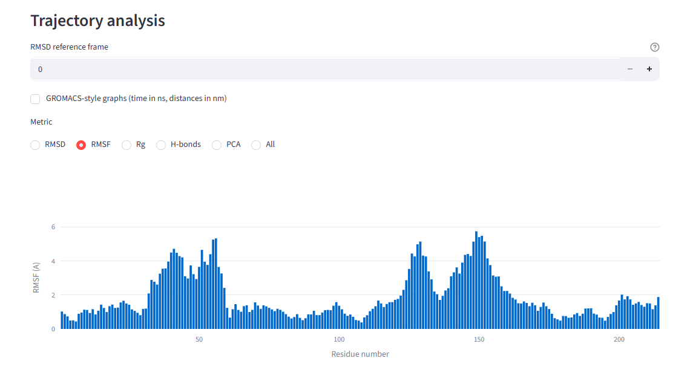

**Torsion angles** of one residue (here GLY 12) over the whole trajectory, and the
Ramachandran plot of all residues in the frame on screen, the chosen residue in red.

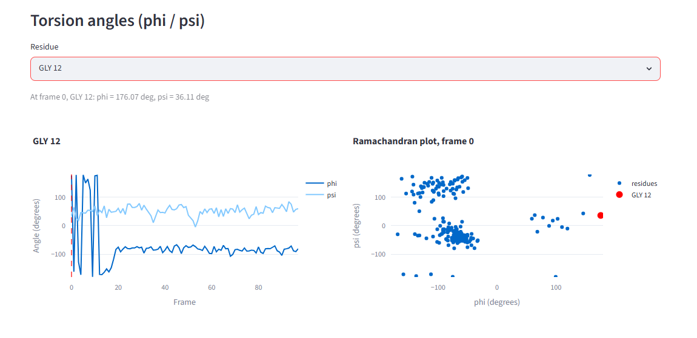

**The download buttons and the numbers for the frame on screen**, including the hydrogen
bonds within and between chains.

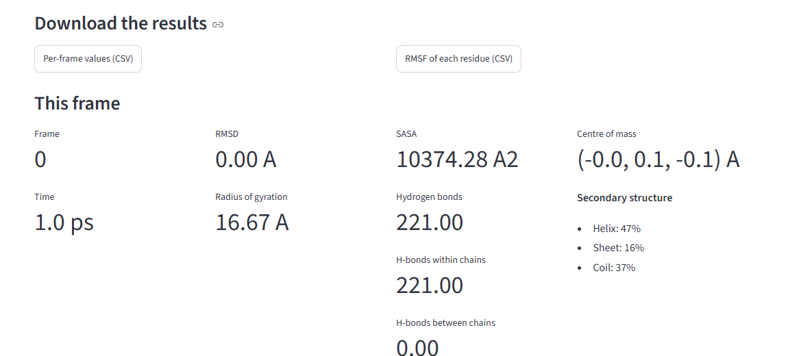

**GROMACS-style graphs and another RMSD reference frame.** The checkbox shows time
in ns and distances in nm. Here frame 30 is the reference, so the curve reaches 0
at frame 30.

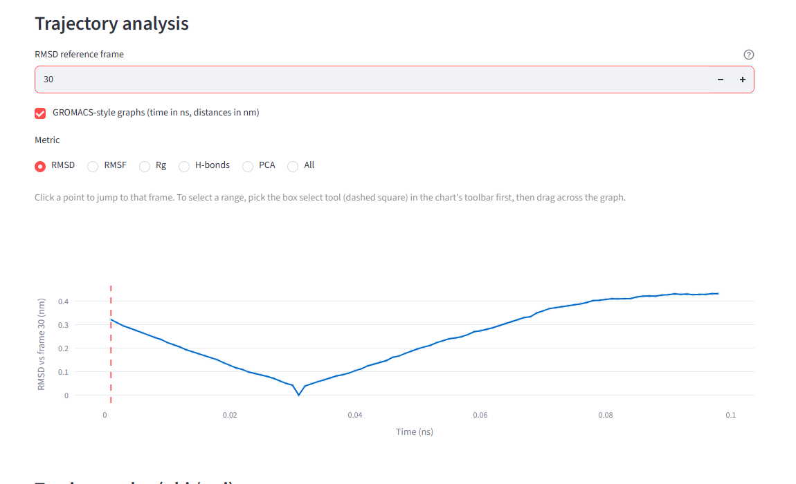

**Periodic-boundary warning.** This raw GROMACS output (`adk_oplsaa.gro` +
`adk_oplsaa.xtc`) has the protein cut by the edge of the simulation box, which is
visible in the 3D picture. MDExplorer warns that RMSD, RMSF and the other
measurements may be misleading (see the next section).

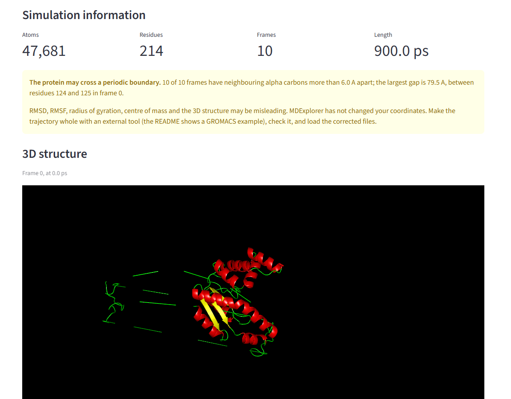

## Periodic-boundary warning

A simulation box repeats itself in space, so MD programs wrap every atom back
into the box. One protein can then end up as pieces on opposite sides of the
box. The files still load and every number is still calculated, but RMSD, RMSF,
radius of gyration, centre of mass and the 3D picture describe the broken
pieces, not the protein. In our test the same GROMACS trajectory gave an RMSD
up to 20.8 A when split and up to 2.0 A once it was made whole.

After loading, MDExplorer therefore checks the distance between neighbouring
alpha carbons (residue n and n+1 of the same chain, which are always about 3.8 A
apart) in every frame and shows one of three answers:

* **Potential split detected**: a pair is more than 6 A apart. A warning names
  the frame and residues. Nothing is blocked and no coordinate is changed.
* **No obvious split detected**: no such pair was found.
* **Unable to assess reliably**: there was nothing to compare (no alpha carbons,
  only one residue per chain, gaps in the residue numbers, or coordinates that
  are not numbers).

What the check cannot do:

* "No obvious split" is **not** a guarantee. It only looks at alpha carbons, so
  it can miss a split in a chain with missing residues, a split between two
  chains, a split that only moves side chains, or a molecule that jumps by less
  than 6 A. It never uses the box size, so a file without a box is not treated
  as safe.
* It can give a false alarm if two chains share one chain label and continue the
  residue numbering (for example chain A ends at residue 214 and chain B starts
  at 215), because the end of one chain then looks like a broken bond.
* The threshold (`CA_JUMP_LIMIT` in `analysis.py`) comes from protein geometry:
  neighbouring alpha carbons are 3.8 A apart (4.1 A at most in our real test
  data), while a split jumps by tens of A.

MDExplorer does not unwrap the coordinates for you. Unwrapping needs the bonds
of the molecule, which GRO and PDB files do not contain, and a wrong guess would
silently change every result. Fix the trajectory with the program that made it
and load the corrected files. For GROMACS, an example is:

```
gmx trjconv -s topol.tpr -f trajectory.xtc -o trajectory_whole.xtc -pbc mol
```

Notes on this command:

* Use your own run-input file (`topol.tpr`) and trajectory; they must belong to
  the same simulation.
* GROMACS asks which group to write out; choose the protein group.
* `-pbc mol` makes each molecule whole. That is not the same as centring the
  protein or removing every jump of the molecule between frames, and some
  simulations or analyses need extra steps (for example `-center`).
* Always check the corrected trajectory (the MDExplorer check, the 3D view and
  the RMSD curve) before trusting the results.

## Validation

The numbers below were measured on the development computer. Every comparison used
the same coordinates, atoms, reference frame and units for both tools.

**A long trajectory of the author's own protein**: a single chain of 450 residues,
7,148 atoms, no water, 10,001 frames over 100 ns (one frame every 10 ps), read every
10th frame (1,001 frames). Differences are in nm, like GROMACS prints them.

| Measurement | Compared with | Result |
| --- | --- | --- |
| RMSD (backbone N, CA, C, O; fitted to frame 0) | MDAnalysis `rms.RMSD`, same definition | identical (largest difference 0.00000 nm) |
| RMSD, as GROMACS defines it | MDAnalysis imitating `gmx rms` defaults: group Backbone (N, CA, C), mass-weighted fit | largest difference 0.0031 nm, average 0.0010 nm (about 0.1%), correlation 0.99999 |
| Radius of gyration (all atoms, mass-weighted) | MDAnalysis `radius_of_gyration` (the definition `gmx gyrate` uses) | identical |
| RMSF of each C-alpha (fitted to frame 0) | MDAnalysis `AlignTraj` + `RMSF` | identical |

For that protein MDExplorer finds an RMSD that rises to 1.39 nm, a radius of gyration
falling from 3.11 to 2.70 nm, and the largest fluctuation (1.92 nm) at residue 430 in the
flexible C-terminal end. Loading all 10,001 frames takes 9 s and 0.9 GB. All seven measurements
for all 10,001 frames took about 220 seconds with Fast SASA, about 70% of it SASA (157 s;
hydrogen bonds 12 s). That timing is from before the load also drew a 3D picture of every frame
and the RMSD against every reference frame, so a load is now slower (see Known limitations).

**GROMACS itself was not installed on the development computer**, so the "as GROMACS
defines it" row is MDAnalysis using GROMACS's definitions, not GROMACS's own output. To finish
the comparison, run these on the whole trajectory (made whole first, see above):

```
gmx rms    -s topol.tpr -f traj_whole.xtc -o rmsd.xvg      (choose Backbone twice)
gmx gyrate -s topol.tpr -f traj_whole.xtc -o gyrate.xvg    (choose Protein)
gmx rmsf   -s topol.tpr -f traj_whole.xtc -res -o rmsf.xvg (choose C-alpha)
```

Then tick **GROMACS-style graphs** in MDExplorer and compare. Three things make curves
differ even when both programs are right:

* `gmx rms` compares every frame with the structure stored in the `.tpr` file, i.e. the
  start of the whole simulation. If your trajectory is a later piece of a run, GROMACS's
  curve does not start at 0; in MDExplorer pick that frame as the **RMSD reference frame**
  (or load the piece that contains it).
* GROMACS's default group "Backbone" has no oxygen and its default fit is mass-weighted
  (`-nomw` turns that off), MDExplorer uses N, CA, C, O unweighted: about 0.1% apart here.
* Use the same frame step (`-dt`) in both.

**The sample protein** (Adenylate Kinase from the MDAnalysis test files, 98 frames):
RMSD, RMSF, radius of gyration and centre of mass agree with MDAnalysis to 1e-6 A; the Kabsch
alignment agrees with SciPy on 200 random cases (including mirror images); hydrogen-bond counts
are identical to mdtraj's Baker-Hubbard on all 98 frames (and to the earlier, slower version of
this code); SASA from freesasa is within 0.03 to 0.74% of mdtraj's on five frames (freesasa uses
different atomic radii); secondary structure agrees with MDAnalysis' own DSSP for 96.6%
of residues.

**The newer measurements.** The phi and psi angles agree with MDAnalysis' `Ramachandran`
analysis to 4 decimal places (cobrotoxin, MDAnalysis test files). The split of hydrogen bonds
was checked on HIV protease (`1hvr.pdb`, two chains): 126 within chains and 21 between them;
a single-chain protein gives 0 between chains. The RMSD table for every reference frame was
checked against a fresh RMSD calculation for that reference. PCA has not been compared with
another program.

**File formats.** The first seven measurements (not yet the torsion angles and PCA) ran on
every combination tried:

| Topology + trajectory | Tested with |
| --- | --- |
| PDB (one frame, or the topology of an XTC) | Adenylate Kinase, and the author's protein with XTC |
| PSF + DCD | Adenylate Kinase |
| GRO + XTC, TPR + XTC | Adenylate Kinase in water |
| GRO + TRR, TPR + TRR | Adenylate Kinase in water |
| PRMTOP + NC, PARM7 + NC | three small Amber examples from the MDAnalysis test files |

TPR files work for SASA and secondary structure too (they are calculated from MDExplorer's own
arrays, not by re-reading the file). A 6-atom Amber fragment has no alpha carbon and no N-H pair,
and MDExplorer says so instead of failing. The extension `.ncdf` is not accepted; rename the file
to `.nc`.

**A real protein with several chains**: insulin (4INS from the Protein Data Bank, 4 chains that
all number their residues from 1). It has 102 residues (not 30), the periodic-boundary check does
not compare across chains, and the RMSF graph draws 102 separate bars in file order with the
real residue number on hover. This crystal structure also has two atoms at exactly the same
position (Val 12, `CG1` and `CG2`). freesasa does not stop or raise an error for such atoms (tested
with a small made-up set of coordinates, not with the 4INS file itself), but the duplicated
atoms hide each other, so the total comes out too low (221 instead of 252 A^2 in that small test).
For a whole protein the effect of one pair is tiny, but MDExplorer does not warn about it.

## Known limitations

* Periodic boundaries are only checked, not corrected; see the section above.
* If several chains reuse the same residue numbers, the RMSF graph is drawn in
  file order (hovering shows the number), and it does not say which chain a bar
  belongs to.
* RMSD uses the backbone N, CA, C, O, unweighted, and always compares with a frame
  of the loaded file (frame 0 unless you pick another). The RMSF is always fitted to
  frame 0. GROMACS's defaults differ slightly (see Validation).
* SASA is the slowest measurement. It uses freesasa, one frame per call, spread over up to 6
  CPU cores (more cores were slower on the test PC). The tick box **Fast SASA** uses 100 sphere
  points per atom instead of 960: about 5x faster, area about 0.5% different.
* An atom whose element cannot be guessed from its name (MDExplorer takes the first
  letter) stops secondary structure with an error message. Protein-only files
  are fine; a metal or an unusual ligand may not be.
* Streamlit's upload limit is raised to 2,000 MB in `.streamlit/config.toml`; a bigger
  trajectory has to be shortened first (for example `gmx trjconv -dt`).
* Loading time depends on the number of frames, the number of atoms and your
  computer. Everything is calculated at load, so loading is the slow part: Adenylate Kinase
  (3,341 atoms, 98 frames, SASA with Fast SASA) took about 200 s on the development PC,
  including a PyMOL picture of every frame. The RMSD against every reference frame grows with
  the square of the number of frames, so a long trajectory should be read with **Use every
  Nth frame**. Older example, before the pictures and the RMSD table were added: a 7,148-atom
  protein, 10,001 frames, took about 220 s with Fast SASA. These are examples, not guarantees.
* Each frame's picture is kept in memory (about 100 KB per frame).
* **Free rotation** builds the 3D shapes of a frame when that frame is shown (about half a
  second, and a few MB sent to the browser), because keeping them for every frame would need
  several MB per frame. The still picture changes frame instantly, and playback uses it.
  Free rotation also needs internet in the browser (three.js is loaded from a CDN), and its
  labels are cleared when the frame changes.
* Only alpha carbons and ligand atoms can be clicked in the 3D view (side chains are not drawn).
* A residue counts as protein if its name is a standard amino acid or one of the common
  force-field and modified names listed in `viewer.py` (HSD, HIE, CYX, MSE, ...). Anything
  else is drawn as a ligand, with pocket dots around it; an unusual residue name may need
  adding to that list.
* The hydrogen-bond split uses the chain (segment) label of each atom. A file that gives all
  chains the same label counts every bond as "within chains".

## Libraries used

| Library | Used for |
| --- | --- |
| MDAnalysis | opening the simulation files |
| NumPy | all the arrays and most of the maths |
| freesasa | SASA |
| mdtraj | DSSP (secondary structure) and the phi / psi angles |
| Streamlit | the web page |
| Plotly | the graphs, and the clickable still 3D picture |
| PyMOL (pymol-open-source-whl) | the 3D pictures, and the 3D shapes for free rotation |
| three.js (loaded in the browser, not installed) | drawing PyMOL's 3D shapes for free rotation |

## Files

There are only four of them:

```
molecule.py    the MolecularSystem class, and reading a file into one
analysis.py    all the measurements, and the CSV files
viewer.py      draws a frame with PyMOL (picture and free-rotation view)
app.py         the Streamlit page, this is what you run
```

Besides them: `.streamlit/config.toml`, which raises the upload limit.

## Running it

Install the requirements once (and again after updating, in case they changed):

```
pip install -r requirements.txt
```

Then start the app:

```
streamlit run app.py
```

It opens at `http://localhost:8501`.

Upload the topology file first (PDB, PSF, GRO, TPR or PRMTOP), then the
trajectory file (DCD, XTC, TRR or NC), and click **Load simulation**. A plain
`.pdb` file already contains coordinates, so for that one no trajectory file is
needed. For a long trajectory, set **Use every Nth frame** before loading.

After changing the code, stop the app (Ctrl + C in the terminal) and start it again;
refreshing the browser alone can keep an old copy of `viewer.py` loaded.
