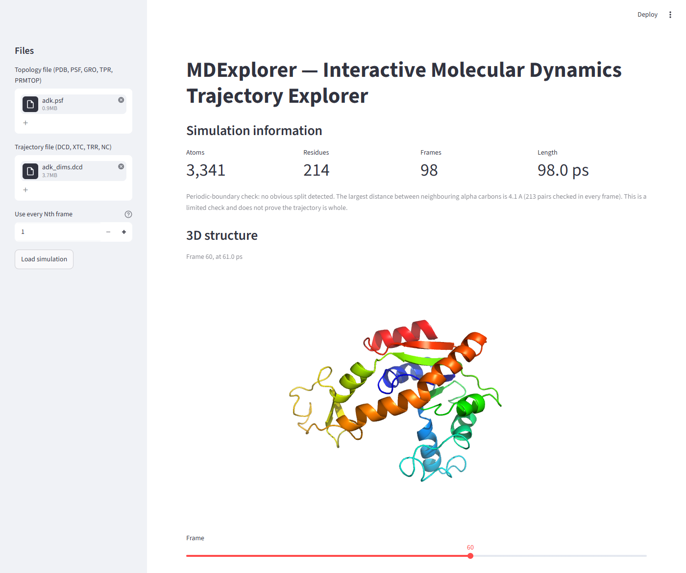
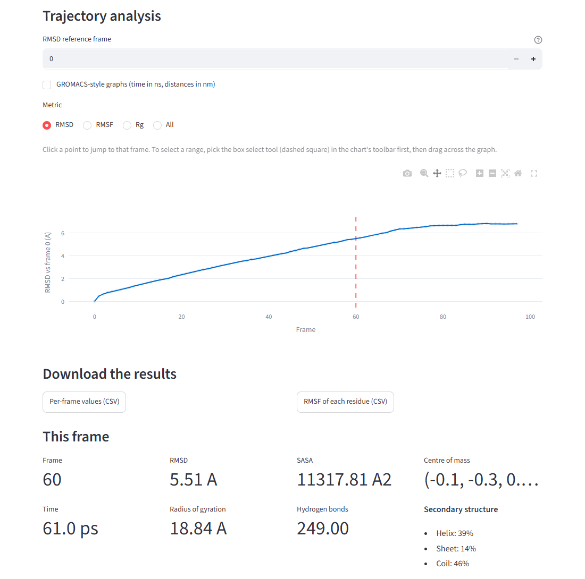
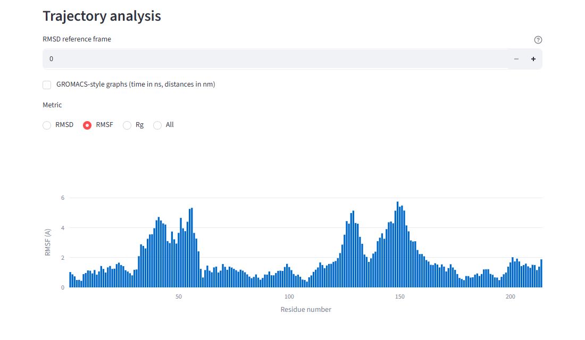
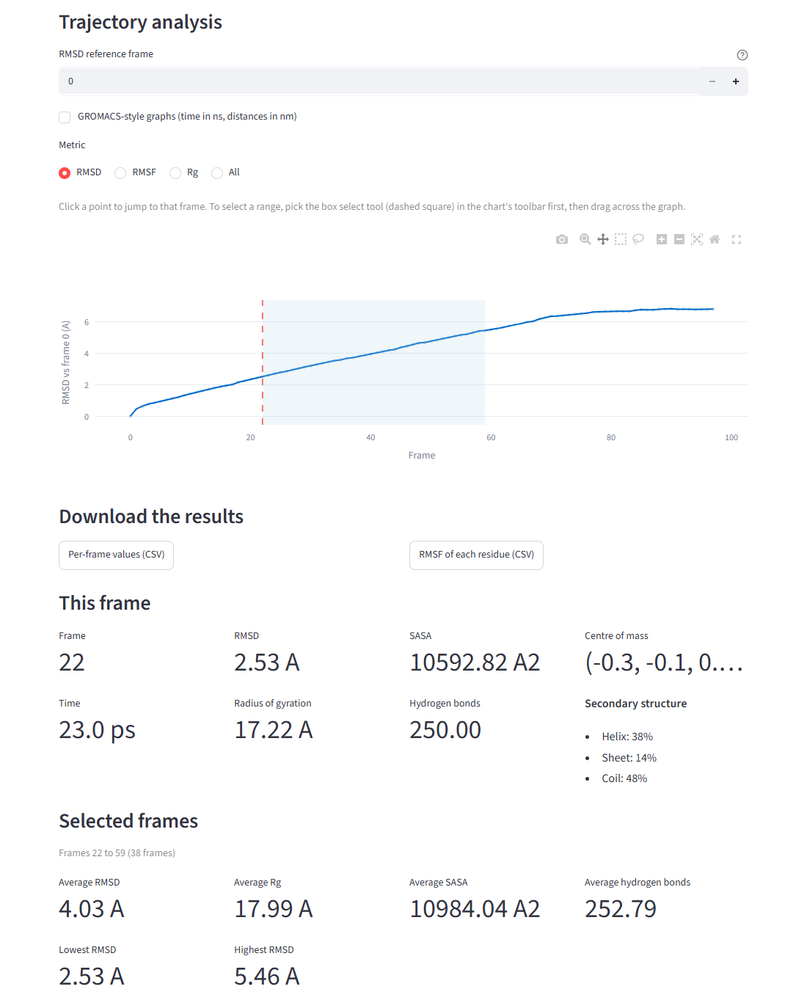
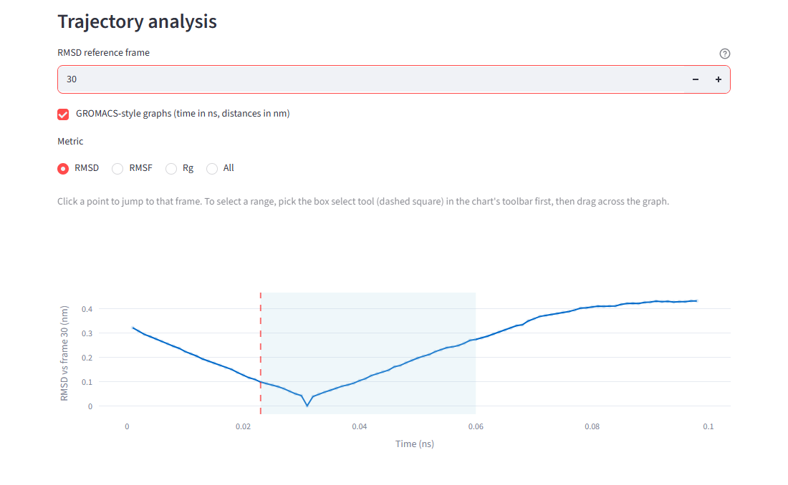
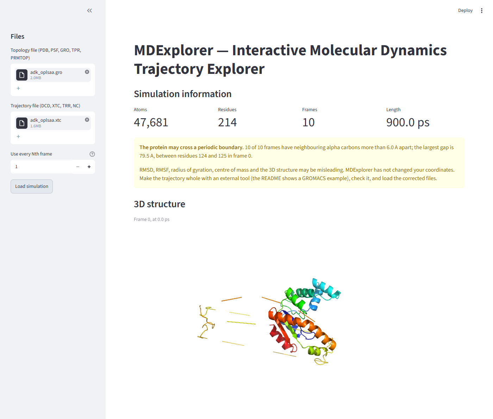

# MDExplorer — Interactive Molecular Dynamics Trajectory Explorer

A tool for exploring molecular dynamics (MD) simulations in the browser. You
upload the files from your simulation, and it shows the protein in 3D together
with graphs of the usual analysis measurements.

## The idea behind it

MD simulations are saved in a lot of different file formats, and every format
stores the same information in a different way. Normally that means writing
separate code for each one.

This project avoids that. It reads the file once, copies everything into plain
NumPy arrays inside a single `MolecularSystem` object, and then forgets where
the data came from. All the analysis code and the 3D viewer only ever talk to
that one object, so adding a new file format means changing only the reader.

```
   PDB                 |
   PSF + DCD           |
   GRO + XTC           |----> MolecularSystem ----> analysis + 3D viewer
   TPR + XTC           |      (NumPy arrays)
   PRMTOP + NC         |
```

A `MolecularSystem` holds:

* one array per atom property, which never changes: `names`, `resids`,
  `resnames`, `elements`, `masses`
* the coordinates, which do change, in one array of shape
  `(n_frames, n_atoms, 3)`
* the time of each frame

## What it measures

Water molecules and ions are removed before every calculation, otherwise the
solvent box around the protein would dominate the results.

| Measurement | What it tells you | How it is done |
| --- | --- | --- |
| RMSD | how far the shape has moved from the starting structure | our own Python code, using the Kabsch algorithm to remove the tumbling of the molecule (NumPy does the SVD step of the alignment) |
| RMSF | which residues are flexible and which are rigid | our own Python code, one value per alpha carbon, aligned with the same Kabsch step as RMSD |
| Radius of gyration | how compact the folded protein is | our own Python code, mass weighted |
| Centre of mass | whether the protein is drifting through the box | our own Python code |
| Hydrogen bonds | whether the folded structure is holding together | our own Python code, the Baker-Hubbard geometric rule: H...acceptor under 2.5 A and a donor-H...acceptor angle over 120 degrees |
| SASA | how much surface is exposed to water | mdtraj (Shrake-Rupley) |
| Secondary structure | the helix / sheet / coil percentages | mdtraj (DSSP, simplified 3-class output: H, E, C) |

The last two use a library because the algorithms behind them are much bigger
than the rest. Everything else is calculated directly from the NumPy arrays.

## What the page does

* the protein is drawn in 3D with PyMOL (rendered as an image of the current
  frame), and a slider moves through the frames
* the graph can be clicked to jump the 3D view to that frame
* dragging a box across the graph selects a range of frames, and the averages
  over that range are shown underneath
* if one measurement cannot be calculated, the page says which one and shows
  the reason, and the other measurements still appear
* **Use every Nth frame** (sidebar): a long trajectory can be read every 10th or
  100th frame. The frames keep their original times and numbers.
* **RMSD reference frame**: RMSD is measured against the first frame unless you
  pick another one. Changing it recalculates only the RMSD.
* **GROMACS-style graphs**: one checkbox switches the graphs to time in ns and
  distances in nm, like `gmx rms`, `gmx gyrate` and `gmx rmsf` plots. Clicking a
  point still jumps to the right frame. The numbers under the graph stay in ps
  and A.
* **Download the results** as two CSV files: every per-frame value, and the RMSF
  of each residue.

## Screenshots

The screenshots use Adenylate Kinase (214 residues, 3,341 atoms, 98 frames)
from the MDAnalysis test files (`adk.psf` + `adk_dims.dcd`).

**Overview: file upload (with "Use every Nth frame"), simulation information and
the 3D structure at the chosen frame.** The slider moves through the frames.



**RMSD graph, the CSV download buttons and the numbers for the frame on screen.**
The red dashed line marks the frame shown in 3D. Clicking a point on the graph
jumps to that frame.



**RMSF per residue**, with the real residue numbers on the x axis.



**Frame-range selection.** Dragging a box across the graph shades the range and
shows the averages (and the lowest and highest RMSD) over those frames.



**GROMACS-style graphs and another RMSD reference frame.** The checkbox shows time
in ns and distances in nm. Here frame 30 is the reference, so the curve reaches 0
at frame 30.



**Periodic-boundary warning.** This raw GROMACS output (`adk_oplsaa.gro` +
`adk_oplsaa.xtc`) has the protein cut by the edge of the simulation box, which is
visible in the 3D picture. MDExplorer warns that RMSD, RMSF and the other
measurements may be misleading (see the next section).



## Periodic-boundary warning

A simulation box repeats itself in space, so MD programs wrap every atom back
into the box. One protein can then end up as pieces on opposite sides of the
box. The files still load and every number is still calculated, but RMSD, RMSF,
radius of gyration, centre of mass and the 3D picture describe the broken
pieces, not the protein. In our test the same GROMACS trajectory gave an RMSD
up to 20.8 A when split and up to 2.0 A once it was made whole.

After loading, MDExplorer therefore checks the distance between neighbouring
alpha carbons (residue n and n+1 of the same chain, which are always about 3.8 A
apart) in every frame and shows one of three answers:

* **Potential split detected**: a pair is more than 6 A apart. A warning names
  the frame and residues. Nothing is blocked and no coordinate is changed.
* **No obvious split detected**: no such pair was found.
* **Unable to assess reliably**: there was nothing to compare (no alpha carbons,
  only one residue per chain, gaps in the residue numbers, or coordinates that
  are not numbers).

What the check cannot do:

* "No obvious split" is **not** a guarantee. It only looks at alpha carbons, so
  it can miss a split in a chain with missing residues, a split between two
  chains, a split that only moves side chains, or a molecule that jumps by less
  than 6 A. It never uses the box size, so a file without a box is not treated
  as safe.
* It can give a false alarm if two chains share one chain label and continue the
  residue numbering (for example chain A ends at residue 214 and chain B starts
  at 215), because the end of one chain then looks like a broken bond.
* The threshold (`CA_JUMP_LIMIT` in `analysis.py`) comes from protein geometry:
  neighbouring alpha carbons are 3.8 A apart (4.1 A at most in our real test
  data), while a split jumps by tens of A.

MDExplorer does not unwrap the coordinates for you. Unwrapping needs the bonds
of the molecule, which GRO and PDB files do not contain, and a wrong guess would
silently change every result. Fix the trajectory with the program that made it
and load the corrected files. For GROMACS, an example is:

```
gmx trjconv -s topol.tpr -f trajectory.xtc -o trajectory_whole.xtc -pbc mol
```

Notes on this command:

* Use your own run-input file (`topol.tpr`) and trajectory; they must belong to
  the same simulation.
* GROMACS asks which group to write out; choose the protein group.
* `-pbc mol` makes each molecule whole. That is not the same as centring the
  protein or removing every jump of the molecule between frames, and some
  simulations or analyses need extra steps (for example `-center`).
* Always check the corrected trajectory (the MDExplorer check, the 3D view and
  the RMSD curve) before trusting the results.

## Validation

The numbers below were measured on the development computer. Every comparison used
the same coordinates, atoms, reference frame and units for both tools.

**A long trajectory of the author's own protein**: a single chain of 450 residues,
7,148 atoms, no water, 10,001 frames over 100 ns (one frame every 10 ps), read every
10th frame (1,001 frames). Differences are in nm, like GROMACS prints them.

| Measurement | Compared with | Result |
| --- | --- | --- |
| RMSD (backbone N, CA, C, O; fitted to frame 0) | MDAnalysis `rms.RMSD`, same definition | identical (largest difference 0.00000 nm) |
| RMSD, as GROMACS defines it | MDAnalysis imitating `gmx rms` defaults: group Backbone (N, CA, C), mass-weighted fit | largest difference 0.0031 nm, average 0.0010 nm (about 0.1%), correlation 0.99999 |
| Radius of gyration (all atoms, mass-weighted) | MDAnalysis `radius_of_gyration` (the definition `gmx gyrate` uses) | identical |
| RMSF of each C-alpha (fitted to frame 0) | MDAnalysis `AlignTraj` + `RMSF` | identical |

For that protein MDExplorer finds an RMSD that rises to 1.39 nm, a radius of gyration
falling from 3.11 to 2.70 nm, and the largest fluctuation (1.92 nm) at residue 430 in the
flexible C-terminal end. Loading all 10,001 frames takes 9 s and 0.9 GB. All seven measurements
for every 100th frame (101 frames) took about 6.5 minutes, nearly all of it SASA (about 3 s
per frame; hydrogen bonds about 0.4 s per frame).

**GROMACS itself was not installed on the development computer**, so the "as GROMACS
defines it" row is MDAnalysis using GROMACS's definitions, not GROMACS's own output. To finish
the comparison, run these on the whole trajectory (made whole first, see above):

```
gmx rms    -s topol.tpr -f traj_whole.xtc -o rmsd.xvg      (choose Backbone twice)
gmx gyrate -s topol.tpr -f traj_whole.xtc -o gyrate.xvg    (choose Protein)
gmx rmsf   -s topol.tpr -f traj_whole.xtc -res -o rmsf.xvg (choose C-alpha)
```

Then tick **GROMACS-style graphs** in MDExplorer and compare. Three things make curves
differ even when both programs are right:

* `gmx rms` compares every frame with the structure stored in the `.tpr` file, i.e. the
  start of the whole simulation. If your trajectory is a later piece of a run, GROMACS's
  curve does not start at 0; in MDExplorer pick that frame as the **RMSD reference frame**
  (or load the piece that contains it).
* GROMACS's default group "Backbone" has no oxygen and its default fit is mass-weighted
  (`-nomw` turns that off), MDExplorer uses N, CA, C, O unweighted: about 0.1% apart here.
* Use the same frame step (`-dt`) in both.

**The sample protein** (Adenylate Kinase from the MDAnalysis test files, 98 frames):
RMSD, RMSF, radius of gyration and centre of mass agree with MDAnalysis to 1e-6 A; the Kabsch
alignment agrees with SciPy on 200 random cases (including mirror images); hydrogen-bond counts
are identical to mdtraj's Baker-Hubbard on all 98 frames; SASA of a single isolated carbon is
120.76 A^2, the analytic value; secondary structure agrees with MDAnalysis' own DSSP for 96.6%
of residues.

**File formats.** All seven measurements ran on every combination tried:

| Topology + trajectory | Tested with |
| --- | --- |
| PDB (one frame, or the topology of an XTC) | Adenylate Kinase, and the author's protein with XTC |
| PSF + DCD | Adenylate Kinase |
| GRO + XTC, TPR + XTC | Adenylate Kinase in water |
| GRO + TRR, TPR + TRR | Adenylate Kinase in water |
| PRMTOP + NC, PARM7 + NC | three small Amber examples from the MDAnalysis test files |

TPR files work for SASA and secondary structure too (they are calculated from MDExplorer's own
arrays, not by re-reading the file). A 6-atom Amber fragment has no alpha carbon and no N-H pair,
and MDExplorer says so instead of failing. The extension `.ncdf` is not accepted; rename the file
to `.nc`.

**A real protein with several chains**: insulin (4INS from the Protein Data Bank, 4 chains that
all number their residues from 1). It has 102 residues (not 30), the periodic-boundary check does
not compare across chains, and the RMSF graph draws 102 separate bars in file order with the
real residue number on hover. This crystal structure also has two atoms at exactly the same
position (Val 12, `CG1` and `CG2`): mdtraj's SASA code would stop the whole program, so MDExplorer
reports it as an error for SASA only and everything else still works.

## Known limitations

* Periodic boundaries are only checked, not corrected; see the section above.
* If several chains reuse the same residue numbers, the RMSF graph is drawn in
  file order (hovering shows the number), and it does not say which chain a bar
  belongs to.
* RMSD uses the backbone N, CA, C, O, unweighted, and always compares with a frame
  of the loaded file (frame 0 unless you pick another). The RMSF is always fitted to
  frame 0. GROMACS's defaults differ slightly (see Validation).
* SASA is skipped, with a message, for a structure that has two atoms at exactly the
  same position.
* An atom whose element cannot be guessed from its name (MDExplorer takes the first
  letter) stops SASA and secondary structure with an error message. Protein-only files
  are fine; a metal or an unusual ligand may not be.
* Streamlit's upload limit is raised to 2,000 MB in `.streamlit/config.toml`; a bigger
  trajectory has to be shortened first (for example `gmx trjconv -dt`).
* Loading time depends on the number of frames, the number of atoms and your
  computer. SASA is the slowest measurement because it is deliberately run on
  one thread, one frame at a time: mdtraj's multi-threaded version sometimes
  returned a wrong value for a frame when the computer was busy, and it made
  every frame after the first about 0.1% too large. Example from one machine (a
  Windows PC with 12 logical cores, Adenylate Kinase with 3,341 protein atoms):
  SASA took about 0.6 s per frame (98 frames in about 60 s) and hydrogen bonds
  about 0.1 s per frame. For a 7,148-atom protein SASA took about 3 s per frame.
  These are examples, not guarantees; a long trajectory can take hours, so use
  **Use every Nth frame**.

## Libraries used

| Library | Used for |
| --- | --- |
| MDAnalysis | opening the simulation files |
| NumPy | all the arrays and most of the maths |
| mdtraj | SASA and DSSP |
| Streamlit | the web page |
| Plotly | the graphs |
| PyMOL (pymol-open-source-whl) | the 3D view |

## Files

There are only four of them:

```
molecule.py    the MolecularSystem class, and reading a file into one
analysis.py    all seven measurements, and the CSV files
viewer.py      writes a frame as PDB text and draws it in 3D
app.py         the Streamlit page, this is what you run
```

Besides them: `.streamlit/config.toml`, which raises the upload limit.

## Running it

Install the requirements once:

```
pip install -r requirements.txt
```

Then start the app:

```
streamlit run app.py
```

It opens at `http://localhost:8501`.

Upload the topology file first (PDB, PSF, GRO, TPR or PRMTOP), then the
trajectory file (DCD, XTC, TRR or NC), and click **Load simulation**. A plain
`.pdb` file already contains coordinates, so for that one no trajectory file is
needed. For a long trajectory, set **Use every Nth frame** before loading.
